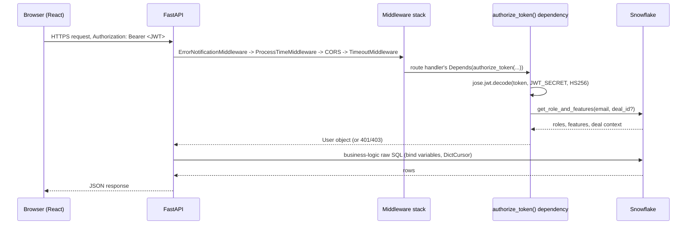
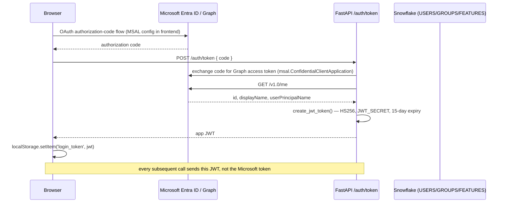
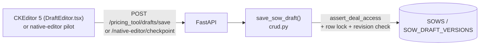
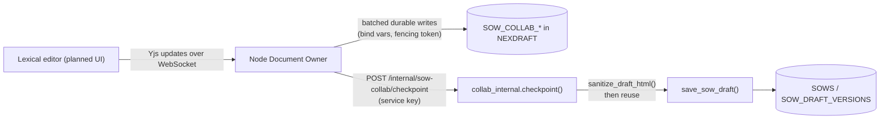

# System Architecture

This describes the architecture as verified from source (see `REPOSITORY_MAP.md` for the file
paths behind each claim). Where the in-progress Lexical/Yjs module is concerned, parts are built
and parts are still planned — each diagram/section says which.

## Overall architecture

```mermaid
flowchart LR
    subgraph Browser
        FE["blend_ode (React CRA)\nantd UI, CKEditor 5"]
    end
    subgraph Backend["blend_ode_be (FastAPI)"]
        API["FastAPI app\nmain.py"]
        PT["pricing_tool router"]
        SS["sow_studio router\n(+ native + public)"]
        SM["sow_module router\n(session + internal)"]
        AUTH["auth router"]
        ADM["admin router"]
    end
    SF[(Snowflake\nmain schema)]
    SF2[(Snowflake\nBLEND_INTERNAL_IT_APPS.NEXDRAFT)]
    HS[HubSpot]
    OA[OpenAir]
    S3[(AWS S3)]
    AI[Anthropic Claude\n(direct or via Bedrock)]
    MS[Microsoft Entra ID / Graph]

    FE -- "HTTPS + JWT\n(axios, Authorization: Bearer)" --> API
    API --> PT & SS & SM & AUTH & ADM
    PT -- raw SQL --> SF
    SS -- raw SQL --> SF
    AUTH -- raw SQL --> SF
    SM -- "internal, service-key\n(resolve-access, document-state, checkpoint)" --> SS
    AUTH -- OAuth code exchange --> MS
    SS -- deal data / publish --> HS
    PT -- bookings/employees --> OA
    SS -- material upload/download --> S3
    SS -- "Deal Desk agents" --> AI

    subgraph Collab["sow_module Node service (in progress, not yet deployed)"]
        OWNER["Document Owner\nExpress + ws + Yjs"]
    end
    FE -. "planned: WebSocket\n(ticket-authenticated)" .-> OWNER
    OWNER -- "SnowflakeDataStore\n(bind vars only)" --> SF2
    OWNER -. "service-key HTTP calls\n(built, not yet invoked end-to-end)" .-> SM
```

**Verified vs. planned in this diagram**: everything in the `Backend` subgraph and its database/
integration edges is built and live. The `Collab` subgraph (the Node "Document Owner" service) has
its data layer (`SnowflakeDataStore`) and the FastAPI-side endpoints it will call both built and
tested, but the Express/`ws` server itself, the browser WebSocket client, and the live wiring
between them do not exist yet — see `CURRENT_PROJECT_STATE.md`.

## Component responsibilities

| Component | Responsibility | Never does |
|---|---|---|
| `blend_ode` (React) | Renders UI, holds the user's JWT in `localStorage`, calls the backend via axios | Talk to Snowflake directly; hold any secret beyond its own build-time env vars |
| `blend_ode_be` FastAPI app | Auth, authorization, all business logic, the only writer to the app's core Snowflake tables | Run in the browser; the `sow_module` router specifically never writes `SOWS`/`SOW_DRAFT_VERSIONS` except through the existing `save_sow_draft` |
| `blend_ode_be`'s `sow_module` Node service (planned) | Holds live Yjs documents in memory, persists to its own `SOW_COLLAB_*` tables, brokers access checks through FastAPI | Touch `SOWS`, `SOW_DRAFT_VERSIONS`, `HUBSPOT_DEALS`, or `SOW_NATIVE_*` directly — ever |
| Snowflake (main schema) | System of record for deals, users, SOWs, drafts | — |
| Snowflake (`NEXDRAFT` schema) | System of record for live-collaboration working state only (disposable/rebuildable from HTML) | Hold anything that isn't rebuildable from the main schema's HTML |

## Request lifecycle (a typical authenticated API call)



## Authentication flow (login, verified)



The frontend's own MSAL wiring (whether `@azure/msal-browser`/`msal-react` actually drives the
authorization-code redirect, vs. some other code path producing the `code`) was **not fully
confirmed** — `MsalConfig.ts` exists with real Azure AD identifiers, but no MSAL SDK package is in
`package.json` dependencies. Flagged in `KNOWN_ISSUES_AND_BLOCKERS.md`.

## Data flow: SOW checkpoint (today's CKEditor/native-editor path)



## Data flow: SOW checkpoint (planned, Lexical/Yjs path — endpoints built, wiring pending)



`checkpoint()`'s fencing-token field is accepted but **not yet independently re-verified** by
FastAPI against the lease table (`SOW_COLLAB_LEASE`) — FastAPI's Snowflake connection targets the
main schema, not `NEXDRAFT`. This is a documented, explicit scope decision (see
`sow_docs/tracking/decisions.md` ADR-007 and ADR-012's consequences), not an oversight — flagged
again in `KNOWN_ISSUES_AND_BLOCKERS.md` for visibility.

## External service integrations (verified; see `ENVIRONMENT_AND_SECRETS.md` for the env vars)

| Service | Direction | Purpose |
|---|---|---|
| Microsoft Entra ID / Graph | Backend → Microsoft | Login (OAuth code exchange), email sending (`send_mail.py` uses Graph `sendMail`, not SMTP) |
| HubSpot | Backend → HubSpot | Deal property updates (most deal data is read from a Snowflake sync, not live HubSpot calls) |
| OpenAir | Backend → OpenAir | Employee/booking data (XML API, TTL-cached) |
| AWS S3 | Backend → S3 | SOW intake material storage (presigned upload/download) |
| Switchboard | Backend → Switchboard | MSA ticket creation |
| Anthropic Claude (direct or via AWS Bedrock/`strands-agents`) | Backend → Anthropic/AWS | SOW narrative generation, legal/commercial risk review, draft extraction ("Deal Desk" agents) |
| Workato (inferred, not directly confirmed) | External → Snowflake | Likely syncs `HUBSPOT_DEALS`/`PRICING_DEALS` tables; exact mechanism **UNKNOWN — needs verification** |
| Teams (via an internal agent API) | Backend → internal agent service | Fire-and-forget 5xx error alerts |

## Important dependencies (by effect on the system, not an exhaustive package list — see each
repo's manifest for that)

- **Snowflake connector + SQLAlchemy** (backend): connection pooling only; all actual queries are
  raw SQL with bind variables via `DictCursor` — there is no ORM query layer to learn.
- **`jose` (python-jose)** (backend): JWT encode/decode for both the app's login JWT and the new
  collaboration module's short-lived tickets (different secrets, see `INTEGRATION_CONTRACTS.md`).
- **`strands-agents`** (backend): AWS Bedrock SDK wrapper used for the Deal Desk AI agents by
  default; can be swapped for direct Anthropic API calls via `ANTHROPIC_CLIENT_MODE=direct`.
- **`snowflake-sdk` (Node, `sow_module/collab/`)**: the collaboration module's own, independent
  Snowflake connection (key-pair auth, pooled via `generic-pool`) into the `NEXDRAFT` schema —
  entirely separate from the Python backend's Snowflake connection and credentials.
- **Lexical + Yjs** (frontend, installed but not yet wired into any route): the planned editor
  framework and CRDT library for the live-collaboration module.
- **antd** (frontend): the UI component library for essentially the whole app; bootstrap CSS is
  also loaded globally alongside it (verified, not clearly intentional — see `KNOWN_ISSUES_AND_BLOCKERS.md`).
